# Volunteer Manager

This application was designed to aid the Volunteer Organizer Team to track a large number of
volunteers. It includes features for most of the volunteer lifecycle, from scheduling,
volunteer applications, shift management, and volunteer check-in.

It was built for [BSidesCharm](https://bsidescharm.org/)'s volunteer program, and is meant to
be reusable: the conference's name, logos, contact details, landing page, signup questions and
emails are all set from the admin site, not in the code.

**Documentation:** <https://securgeek.github.io/volunteer-manager/>

## What it does

- **Volunteer portal:** a public call for volunteers, email-first signup with magic-link
  sign-in (no passwords), shift picking with live space counts, and a page where volunteers
  can change their shifts, cancel or rejoin.
- **Organizer app:**
  - a schedule builder and editor;
  - approval of new signups, and assigning volunteers to shifts;
  - schedule emails with check-in QR codes;
  - check-in by scanning those codes, radio checkout, and notes and ratings;
  - passkey or password sign-in, with roles for the check-in desk and read-only users.
- **Export API:** read-only, scoped bearer keys for other servers.
- **Audit log and security alerts:** every sign-in, change and refusal is recorded, and
  searchable in the organizer app. Attack patterns, sign-in floods, account changes and
  input the volunteer pages could never send are emailed to the organizers who can read the
  log, at most once an hour per cause.
- **Privacy by design:** volunteers' email addresses are stored only encrypted, to a key the
  organizers hold offline. The internet-facing portal is a separate application with its own
  database, and can't read them.

## For organizers

The organizer app, from a fresh install to a staffed schedule. The screenshots come from a demo
with invented data; [`tools/gather-screenshots`](tools/gather-screenshots/) retakes them.

### Conference setup

A fresh install opens a setup wizard. After the first organizer account, it asks for the
conference's name and how volunteers can reach the organizers, then its logo. All of it shows
on the public volunteer pages and can be changed later in App Settings.

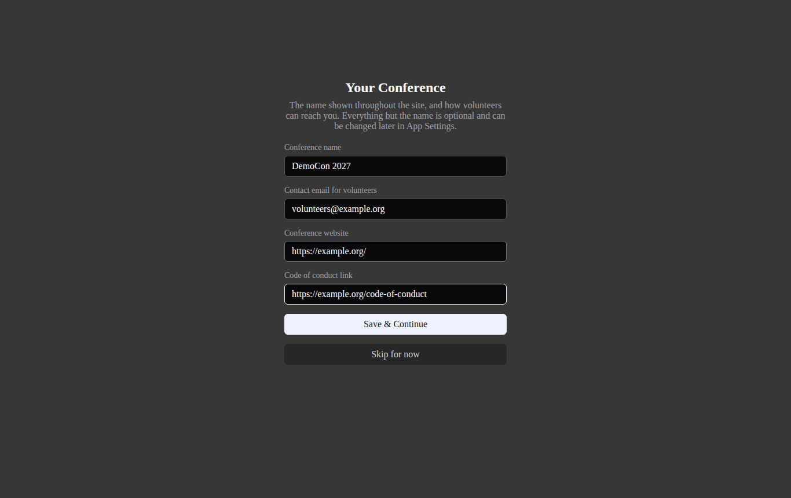

### Schedule creation

The schedule builder steps through days, position categories and shift times, then a grid of
how many of each position every shift needs. Categories are numbered (Security 1, 2, 3 …) or
take a list of names, and each day can run its own set of times.

**Categories**

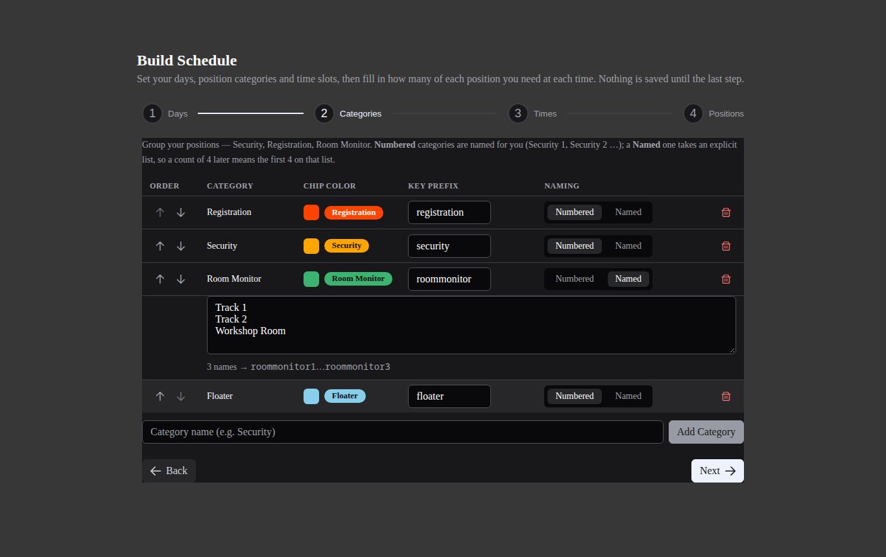

**Times**

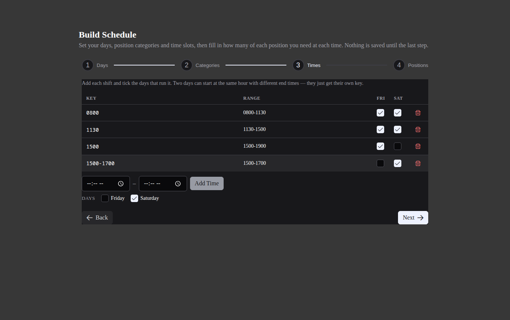

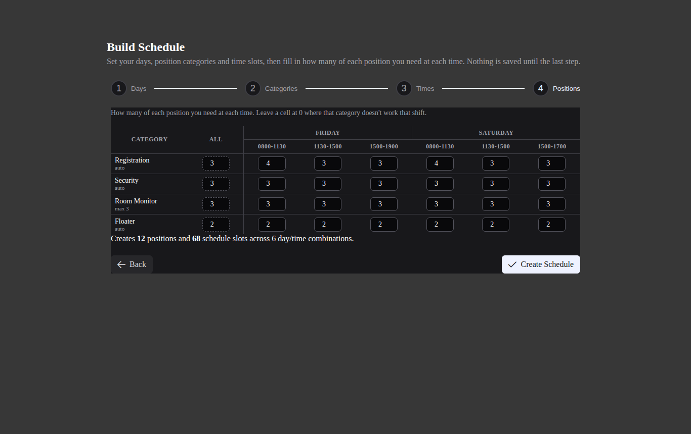

### Volunteer approval

Signups arrive from the volunteer portal as pending, with their shift picks and answers.
Approving can give a volunteer their badge number as their ID. The Volunteers tab lists
everyone by state, with what they asked for and how many shifts they hold.

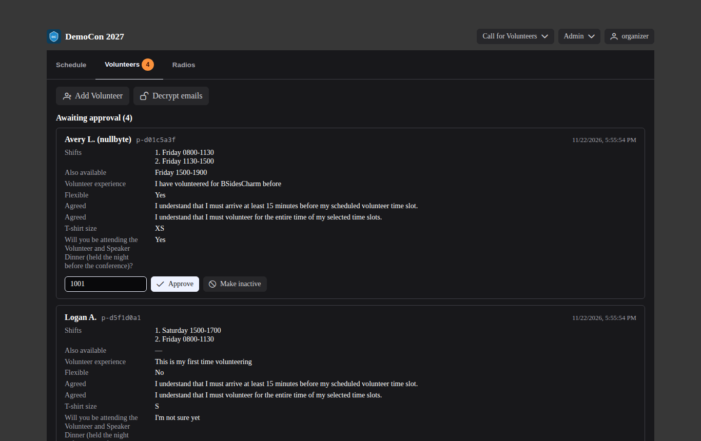

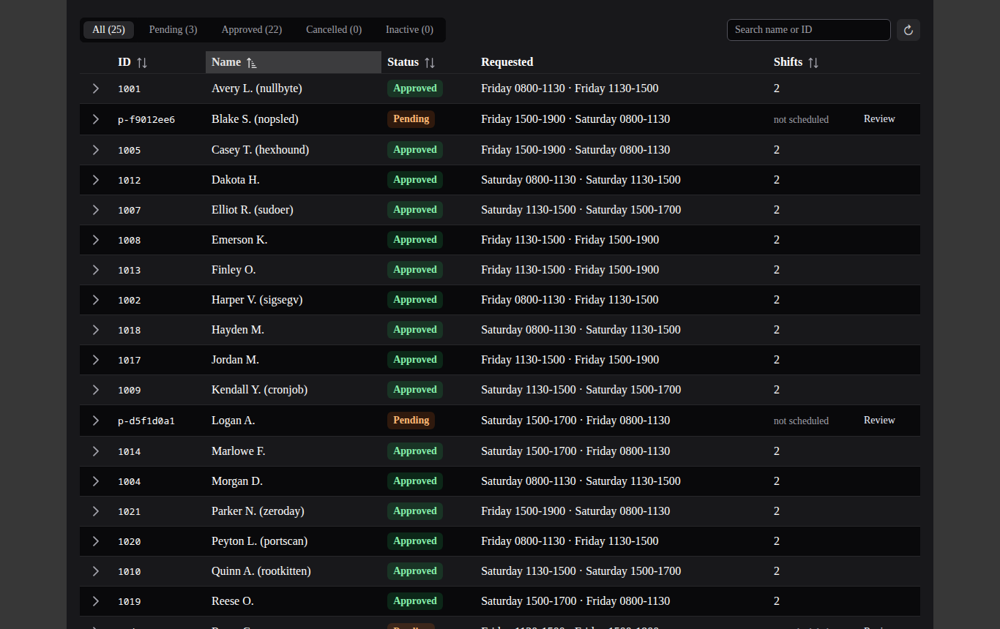

### Schedule assignments

The Schedule tab shows every position by day and shift, colored by category. Opening an empty
slot offers the volunteers who asked for that shift first, then flexible and available ones,
leaving out anyone already working an overlapping shift.

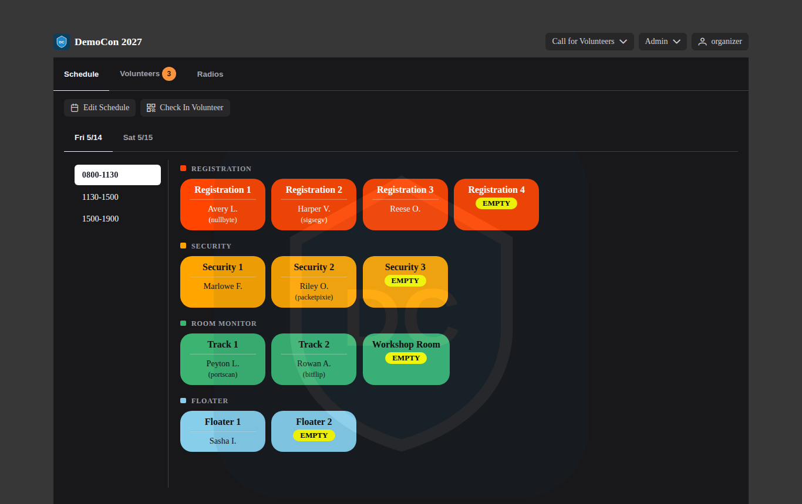

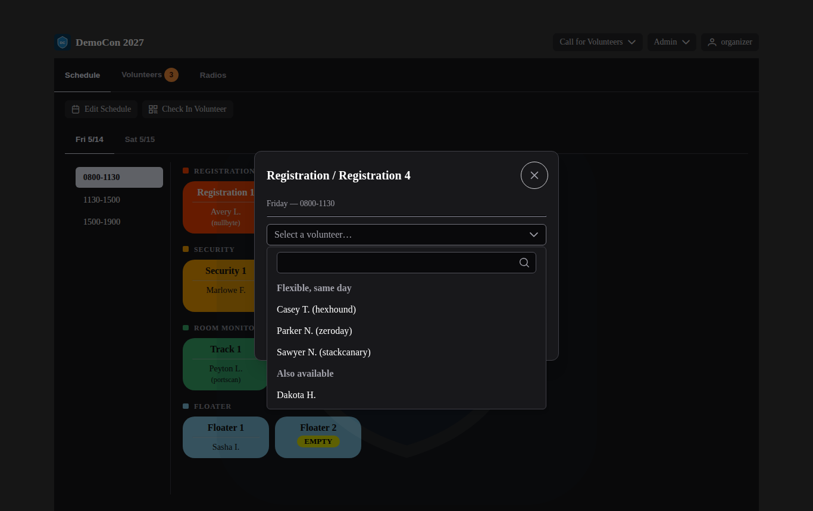

## For volunteers

The public side, on its own hostname: a call for volunteers, then sign-up and sign-in by
emailed link, with no passwords.

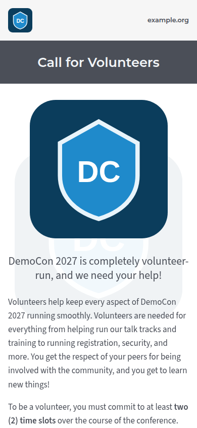

### Signing in

A volunteer enters their address and gets a one-time link. Opening the link changes nothing
until they press Sign in, so mail scanners that follow links can't use it up.

| Ask for a link | Check your email | Confirm |
|---|---|---|
| 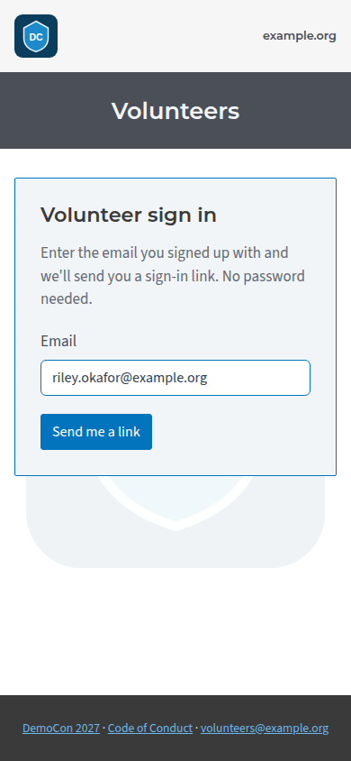 | 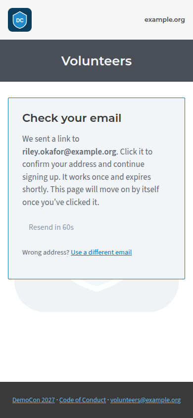 | 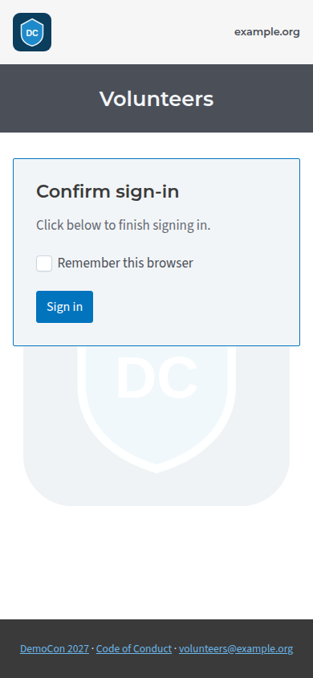 |

### The signup questionnaire

New volunteers give their name, pick two shifts that don't overlap (with space left shown for
each), say when else they could help, and answer the organizers' questions. The questions are
edited on the admin site.

<table>
  <tr>
    <th>About you</th>
    <th>Shifts</th>
    <th>More questions</th>
  </tr>
  <tr>
    <td valign="top">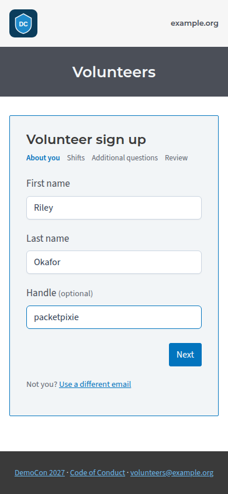</td>
    <td valign="top">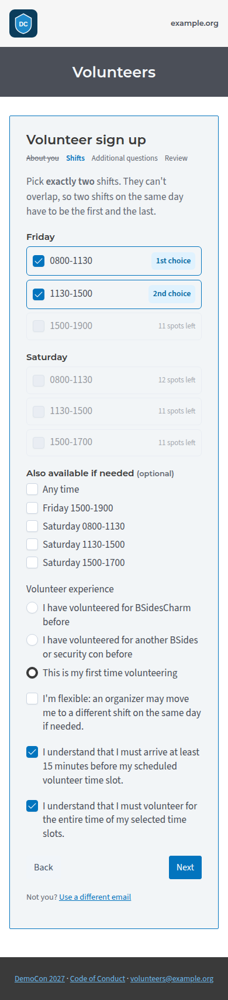</td>
    <td valign="top">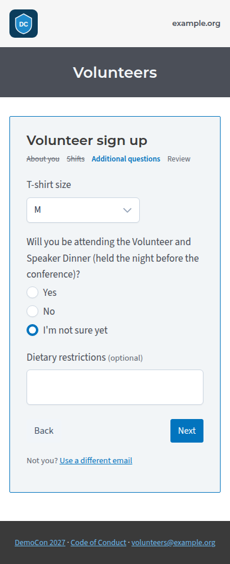</td>
  </tr>
</table>

### Changing a registration

Signed in, volunteers see their status and scheduled shifts, and can change their shifts and
editable answers, or cancel.

<table>
  <tr>
    <th>My info</th>
    <th>Editing</th>
  </tr>
  <tr>
    <td valign="top">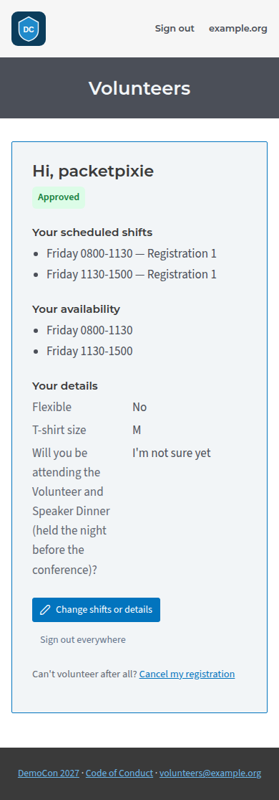</td>
    <td valign="top">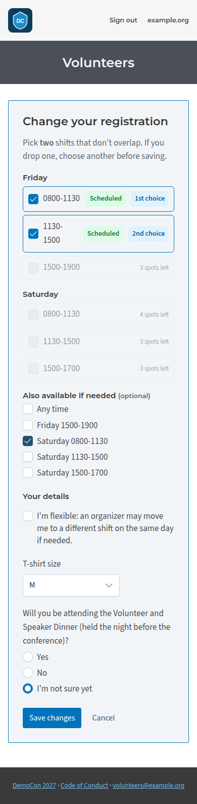</td>
  </tr>
</table>

## How it's built

| Part | What it is |
|---|---|
| `backend/` | The scheduler API: FastAPI on PostgreSQL. The organizers' system of record. |
| `portal/` | The volunteer API: FastAPI on SQLite, a separate app the backend syncs with over a signed, one-way API. |
| `frontend/` | One Vue 3 + PrimeVue build, serving the call for volunteers, the portal pages and the organizer app, behind nginx. |
| `mailrelay/` | Sends the portal's mail through Microsoft Graph. The only part holding the mail credential. |
| `tools/vol_mail/` | A command-line tool, run on an organizer's machine, that sends the schedule emails. |

Everything runs under podman-compose (or Docker Compose) on one host, on Alpine images.

## Quick start

You need podman with podman-compose, or Docker with Compose.

```bash
git clone https://github.com/securgeek/volunteer-manager.git
cd volunteer-manager
cp .env.example .env
openssl rand -hex 32     # run twice: paste one into EMAIL_HMAC_KEY, one into SYNC_SECRET
podman-compose up -d --build        # or: docker compose up -d --build
```

Open <http://localhost:8080>. A fresh install starts a setup wizard: create the first
organizer, name the conference, and build the schedule. With `MAIL_BACKEND=file` (the
default in `.env.example`), sign-in links are written to `logs/portal_mail/` instead of being
sent, so the whole flow works without a mail server.

[Getting started](https://securgeek.github.io/volunteer-manager/latest/getting-started/)
covers the rest, including the key pair that volunteer signup needs.

## Development

```bash
python3 -m venv .venv && . .venv/bin/activate
python -m pip install -r requirements-dev.txt     # includes backend/requirements.txt

./run_tests.sh             # portal, backend and vol_mail suites
./run_lint.sh              # pylint, bandit and a strict docs build
mkdocs serve               # these docs at http://127.0.0.1:8000

cd frontend && npm install && npm run dev        # frontend with hot reload
```

Most backend tests need a throwaway PostgreSQL. They're skipped without one, and they wipe
the database they're pointed at. See
[Getting started → Tests](https://securgeek.github.io/volunteer-manager/latest/getting-started/#tests).

## Documentation

What changed in each release is in [CHANGELOG.md](CHANGELOG.md). The
[documentation site](https://securgeek.github.io/volunteer-manager/) has one version per
release:

- [Organizer guide](https://securgeek.github.io/volunteer-manager/latest/guides/organizer/):
  running volunteers for an event with the admin site.
- [Deployment](https://securgeek.github.io/volunteer-manager/latest/operations/deployment/),
  [Configuration](https://securgeek.github.io/volunteer-manager/latest/operations/configuration/)
  and [Secrets and keys](https://securgeek.github.io/volunteer-manager/latest/operations/secrets/):
  running it in production.
- [Security](https://securgeek.github.io/volunteer-manager/latest/security/): the SBOM, known
  vulnerabilities, and static analysis results.
- [Export API](https://securgeek.github.io/volunteer-manager/latest/api/export/): for
  integrators.
- **Code reference:** every module, generated from its docstrings.

The same pages are in [`docs/`](docs/) as Markdown.

## License

Copyright (C) 2026 James Elliott

Volunteer Manager is free software under the
[GNU Affero General Public License v3.0 or later](LICENSE) (`AGPL-3.0-or-later`). If you run
a modified version as a service, the AGPL asks you to offer its users the source of your
changes.

There's one exception, in [LICENSE-EXCEPTION.md](LICENSE-EXCEPTION.md): **theme files** (the
stylesheets, images, logos, fonts and maintenance page that only change how the volunteer
portal or organizer app looks) can be changed and kept private, or licensed as you choose. The
conference's own content, entered through the admin site, isn't covered by the licence at all.
