# Object interaction diagrams

How the BSides services, and the main objects inside them, talk to each other. Each
diagram is drawn from the code and `compose.yml`. The names are real: routes, functions,
tables and columns.

| # | Diagram | Read it when you're changing… |
|---|---|---|
| 1 | [Deployment and trust boundaries](#1-deployment-and-trust-boundaries) | compose, nginx, the tunnel, anything network-facing |
| 2 | [An organizer change](#2-an-organizer-change) | any backend write endpoint |
| 3 | [One portal sync tick](#3-one-portal-sync-tick) | `portal_sync.py`, `portal/routers/sync.py` |
| 4 | [Volunteer signup](#4-volunteer-signup) | `portal/routers/signup.py`, `auth.py`, the `/apply` pages |
| 5 | [Approval and the push back](#5-approval-and-the-push-back) | `routers/portal_admin.py`, the volunteer push |
| 6 | [An export API call](#6-an-export-api-call) | `api_auth.py`, `routers/export.py` |
| 7 | [A schedule email round](#7-a-schedule-email-round) | `email_template.py`, `tools/vol_mail/` |
| 8 | [Shift check-in](#8-shift-check-in) | `checkin_codes.py`, `routers/checkin.py` |
| 9 | [Admin invite and reset mail](#9-admin-invite-and-reset-mail) | `invites.py`, `password_reset.py`, `send_admin_mail` |
| 10 | [Who owns which volunteer column](#10-who-owns-which-volunteer-column) | any volunteer column, either side |
| 11 | [An early-access invite](#11-an-early-access-invite) | `routers/portal_admin.py` invites, `signup_invites` on either side |
| 12 | [Purging a volunteer](#12-purging-a-volunteer) | `purge_volunteers` on either side, any table holding a `vol_id` |
| 13 | [Passkey sign-in](#13-passkey-sign-in) | `routers/passkeys.py`, `auth.start_session`, `lib/passkey.js` |
| 14 | [From a hostile request to an alert](#14-from-a-hostile-request-to-an-alert) | `security_signals.py`, `portal/validation.py`, `audit.py`, `alerts.py` |

The diagrams are Mermaid. They render on this site, on GitHub, and in VS Code's Markdown
preview with a Mermaid extension. If a diagram and the code disagree, the code is right:
fix the diagram in the same change.

---

## 1. Deployment and trust boundaries

Everything runs under podman-compose on one host. The only way in from the internet is a
tunnel: its client runs on the host, outside compose, and dials the frontend's two
loopback-only ports. Thick lines are internet-facing.

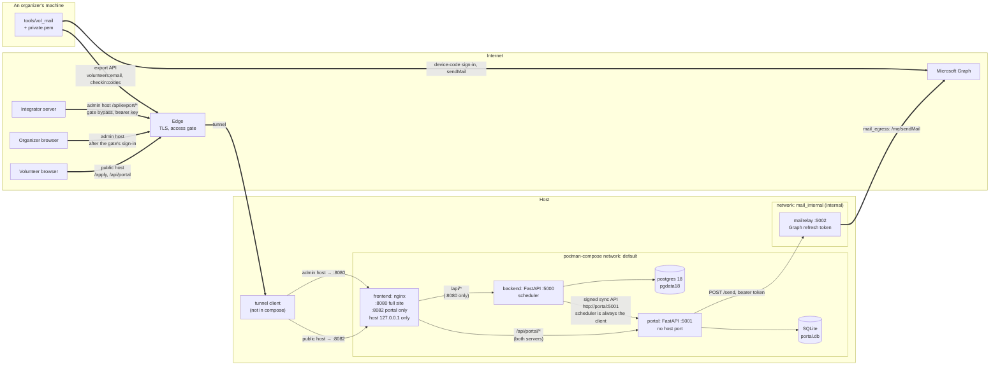

Points the picture makes:

- **The portal never calls the scheduler.** All sync traffic is scheduler → portal, so the
  scheduler needs no inbound route.
- **The public hostname can't reach the scheduler.** nginx's `:8082` server serves the SPA and
  `/api/portal/*` only; `/admin` and every other `/api/*` are a 404 there, and `/api/sync/*`
  isn't under `/api/portal/`. The organizer side is on its own hostname behind an access
  gate, with `/api/export/*` let through for servers, which carry their own bearer keys.
- **Only the mail relay holds the Graph credential.** It sits on an internal-only network
  that the portal shares. Its own egress network reaches Microsoft and nothing else.
- **`private.pem` never reaches the host.** Email addresses are only decrypted on an
  organizer's machine, by vol_mail or by the browser (Volunteers tab → Decrypt).
- **Client IPs:** nginx takes the client IP from the edge's client-IP header, which the edge
  sets, and passes it on as a single `X-Forwarded-For` value (portal/CLAUDE.md → Auth
  invariants).
- **Nothing but the frontend publishes a host port,** and only on `127.0.0.1`, so plain HTTP
  isn't reachable from the LAN.

---

## 2. An organizer change

Any write in the organizer app, for example assigning a volunteer to a slot. The same tail
end runs for every schedule mutation: browsers learn about it over SSE, and the portal gets
it on the next push.

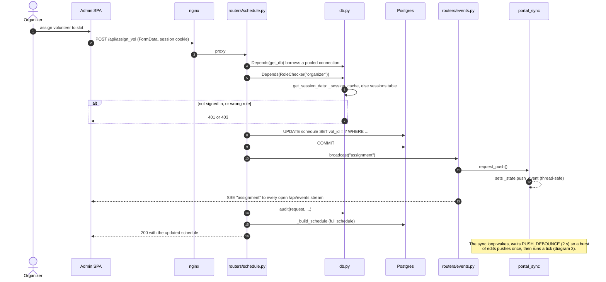

---

## 3. One portal sync tick

`portal_sync._sync_once`, every `PORTAL_SYNC_INTERVAL` seconds (30), or sooner when
`request_push()` wakes it. Every request is signed. The portal rejects any failure with the
same bare 401.

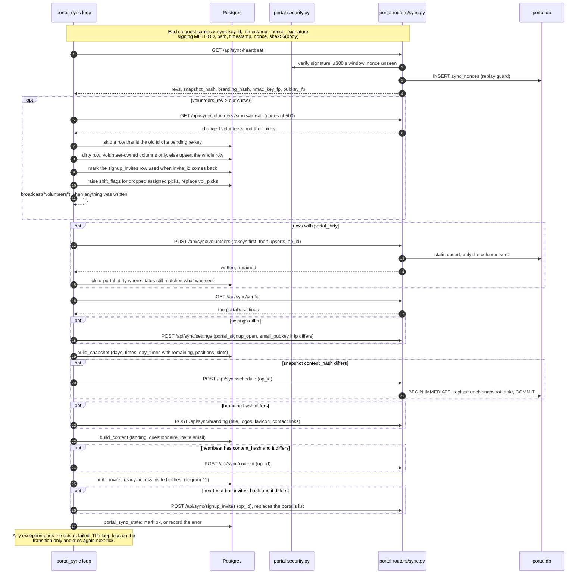

Every POST carries an `op_id`. The portal stores the result in `sync_ops` and replays it for
a repeat, so a push that timed out after the portal committed can be retried safely.

---

## 4. Volunteer signup

Email first. The portal can only ever mail an address someone has just shown they know,
because nothing in it can decrypt `email_enc`.

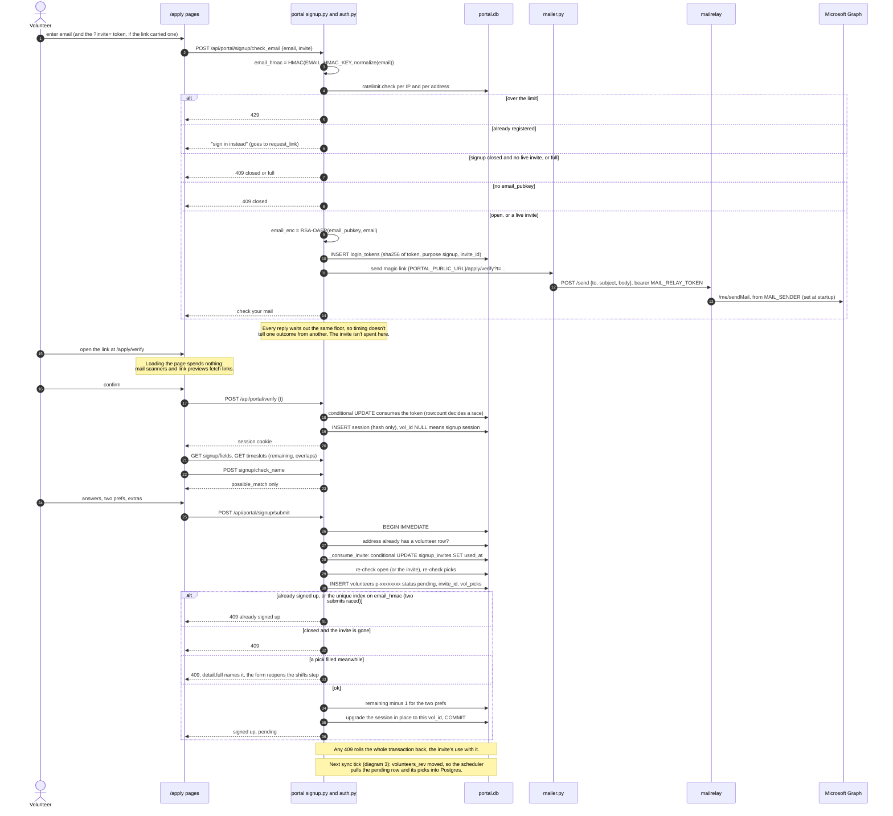

---

## 5. Approval and the push back

An organizer approves a pending signup, optionally giving it a badge number. The request
doesn't call the portal itself: `portal_dirty` marks the row, and `request_push()` wakes the
sync loop, which carries it about `PUSH_DEBOUNCE` (2 s) later. If the portal is down, the
row stays dirty and every later tick retries it.

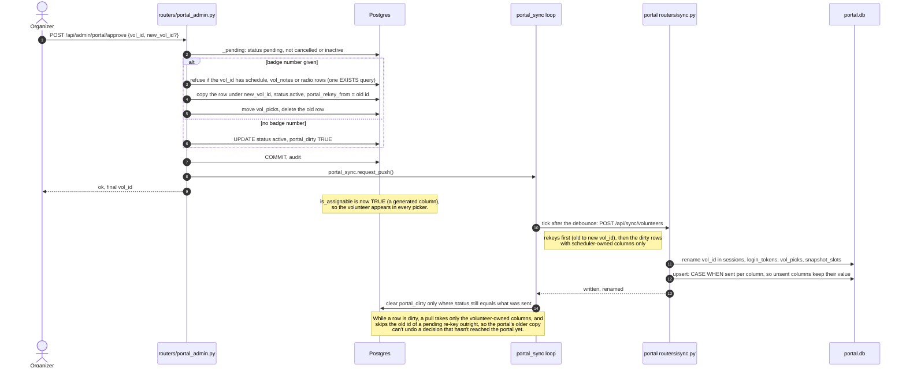

---

## 6. An export API call

A server, or vol_mail, reads the schedule or the volunteers with a bearer key. Every refusal
looks the same.

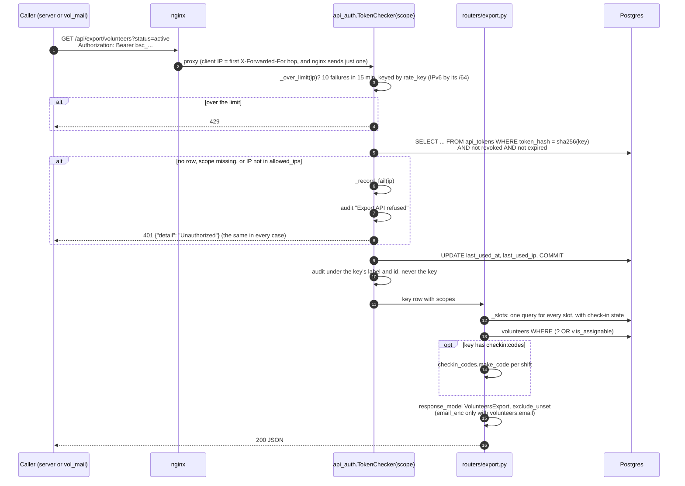

The caller's guide, with every field, is the [Export API](../api/export.md) page, generated
from the same response models.

---

## 7. A schedule email round

The site never sends schedule email. It provides the template and the data; vol_mail, on an
organizer's machine, decrypts the addresses and sends. Usually a draft round, then a final.

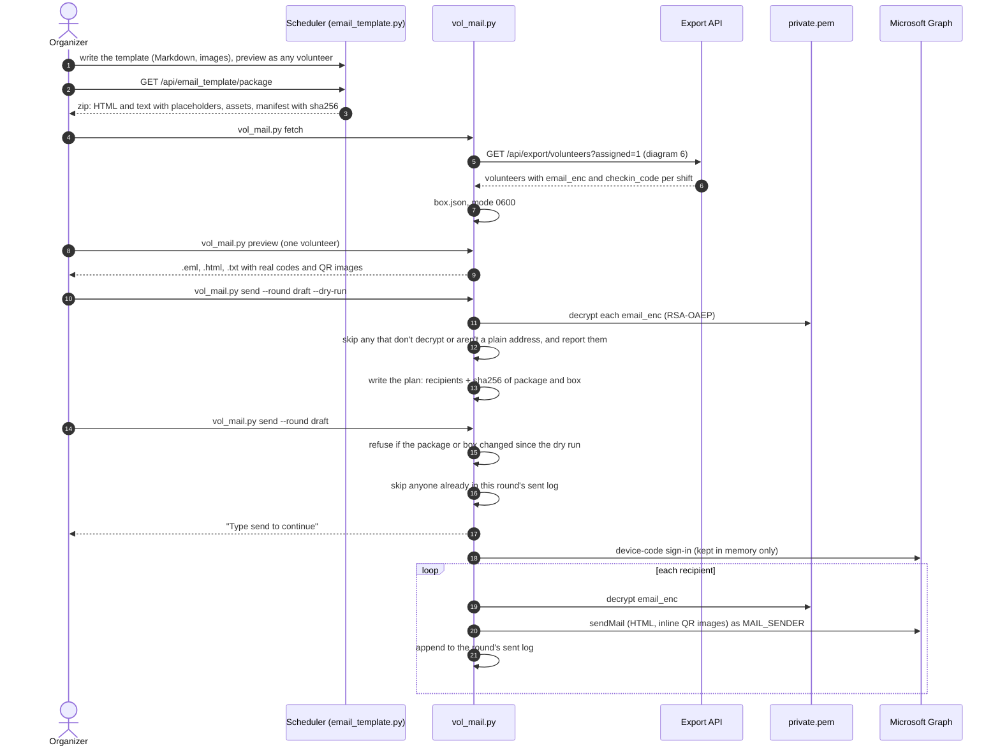

---

## 8. Shift check-in

The QR code in the email is an HMAC over the slot and the volunteer. A valid code isn't
enough on its own: the volunteer must still be assigned to that slot.

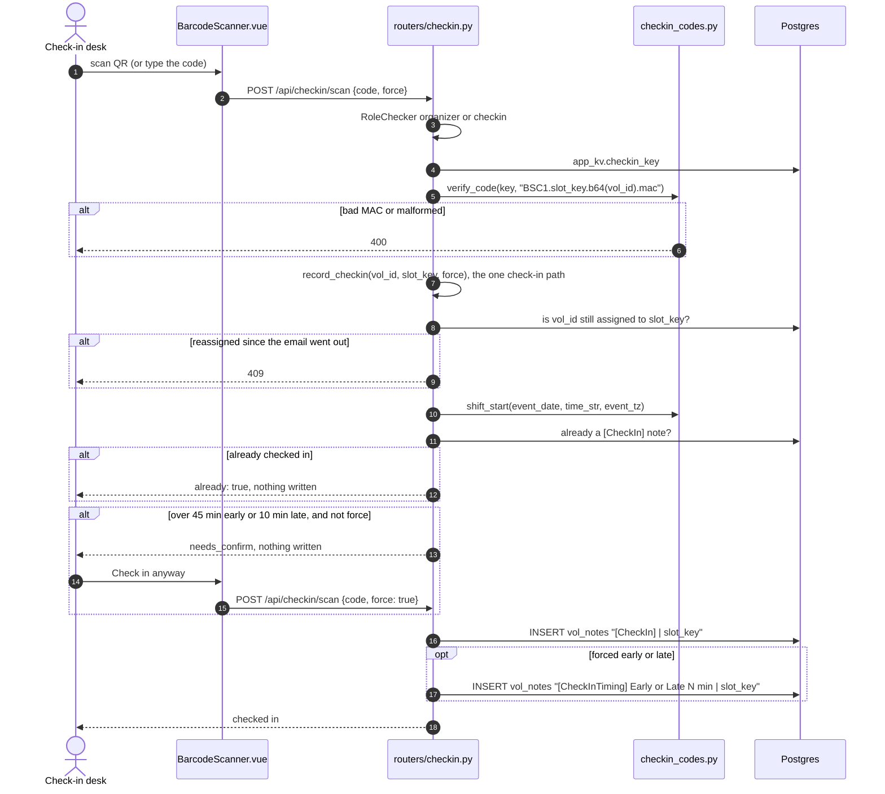

Rotating the key (`POST /api/checkin/rotate_key`) changes `checkin_key`, which voids every
code already mailed.

---

## 9. Admin invite and reset mail

The scheduler has no mail path of its own. It asks the portal, through the one narrow
endpoint that mails an address the portal didn't verify itself. That endpoint takes four
kinds: `invite` and `reset` (drawn here), `signup_invite` (diagram 11) and `alert`
(diagram 14).

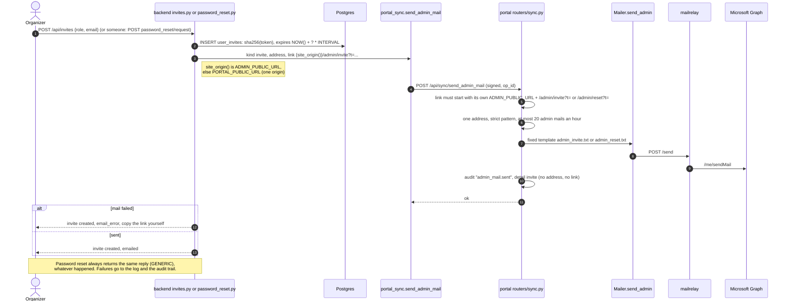

---

## 10. Who owns which volunteer column

A volunteer exists in both databases. Each column has exactly one owner, and each side only
ever sends the columns it owns. That's what lets an approval waiting to go out and an edit
the volunteer just made both survive.

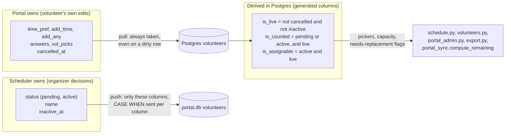

Defined in `portal_sync.VOLUNTEER_OWNED` / `SCHEDULER_OWNED` (scheduler side) and
`routers/sync.PUSH_COLUMNS` (portal side). `cancelled_at` isn't in the portal's push
columns at all, so the scheduler can neither set nor clear it.

---

## 11. An early-access invite

A single-use link that lets one person sign up while the call for volunteers is closed. The
scheduler makes it and keeps only its hash; the portal gets the hashes on the sync, spends
the invite at submit, and the scheduler learns of the use from the next pull. An organizer
can copy a link (`POST /api/admin/portal/invites`) or have it emailed (`.../invites/send`,
drawn here).

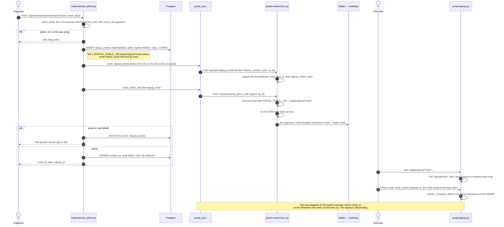

Revoking (`invites/revoke`) sets `revoked_at` and calls `request_push()`; the portal refuses
the link from the next push on.

---

## 12. Purging a volunteer

Deleting a volunteer outright, for clearing test signups so their address can sign up
again. Inactive volunteers only. The portal goes first: deleted here first, the next pull
would bring the volunteer straight back.

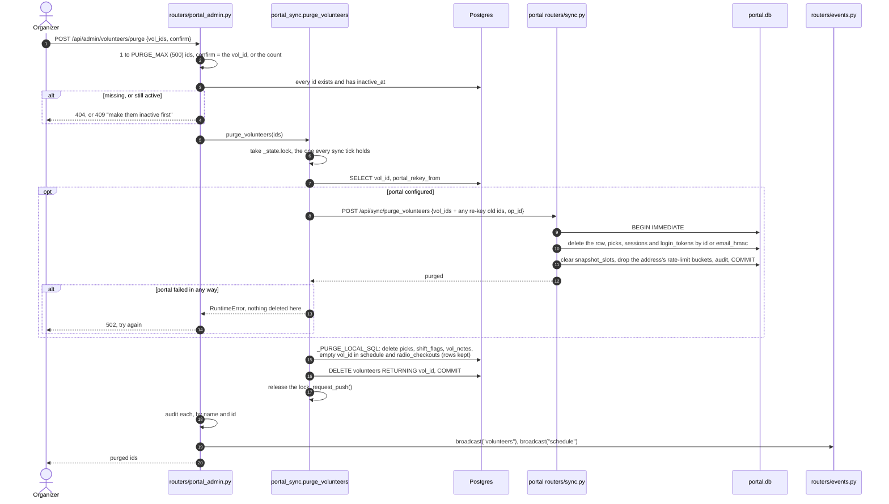

Because the delete runs under the sync lock, a pull already under way finishes first, and
no pull can start between the portal's delete and the scheduler's. Radio history keeps
`person_name`, so a returned radio still says who had it.

---

## 13. Passkey sign-in

An organizer signs in with a passkey instead of a password. No username is typed: the
authenticator offers whatever passkeys it holds for this site. The session at the end is the
one the password login makes, from the same function.

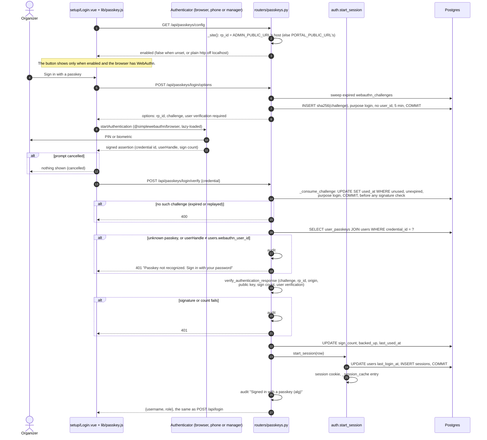

The challenge burns on the first attempt whether the signature then checks or not, so a
captured response is good for nothing. A passkey removed from the account still lives on the
device, which keeps offering it; that's the 401 that says to use the password. Adding a
passkey (`register/options`) needs the current password, so a stolen session cookie can't
plant one.

---

## 14. From a hostile request to an alert

A request to the volunteer portal that looks like an attack, or that the volunteer pages
could never have sent, is noticed on the portal, pulled into the scheduler's audit log on
the next sync tick, and mailed as an alert. A finding on the organizer site takes the same
path from `audit()` on, without the pull. Nothing here blocks the request, except a NUL, or
an anomaly with `PORTAL_STRICT=enforce`.

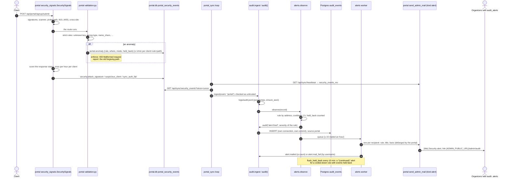
