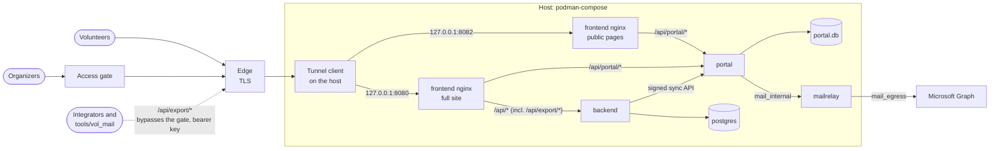

# Deployment

The production site runs on one host under rootless **podman-compose**, reached only
through a **tunnel** from an edge service that terminates TLS and gates the admin site. This page covers how it's laid out, how to ship a change,
and the less routine jobs: the first install, upgrading PostgreSQL and backups.

## Layout



| Hostname | Host port | Serves | Gate |
|---|---|---|---|
| public (`PORTAL_PUBLIC_URL`) | `PORTAL_SITE_PORT` (8082) | `/`, `/apply/*`, assets, `/api/portal/*`. Everything else is a 404. | public |
| admin (`ADMIN_PUBLIC_URL`) | `FRONTEND_PORT` (8080) | the full site: `/admin` and `/api/*` | the access gate, bypassed for `/api/export/*` |

The real hostnames are in `.env`, not in the repo.

- **Nothing else publishes a port.** The portal, the backend, PostgreSQL and the relay are
  reachable only on the compose networks.
- **Both published ports are loopback-only.** TLS ends at the edge, so nginx serves plain
  HTTP that must not be reachable from the LAN.
- **The export API bypasses the gate** because the servers that call it carry a bearer key
  instead. See [Export API](../api/export.md).
- **nginx takes the client address from the edge's client-IP header**, named in
  `frontend/default.conf`. The portal's rate limits depend on it, so a different edge has to
  send that header, or `default.conf` has to name the one it does send.
- **The mail relay is on two networks**: `mail_internal`, shared only with the portal and
  with no route out, and `mail_egress`, its way to Microsoft.

The tunnel client runs on the host, not in compose, so the stack can be rebuilt without
dropping the tunnel.

## Shipping a change

From the directory above the repo on your machine, copy it to the server:

```bash
set -a; . BSides/.env; set +a        # for DEPLOY_HOST
rsync -aF BSides/ "$DEPLOY_HOST:Scheduler/"
```

`.rsync-filter` keeps keys, development tooling, the docs, `tools/` and the legacy app off
the server. It also protects the server's own files, such as `logs/`, so `--delete` is safe
to add. `.env` is copied, because the containers read it. Then, on the server:

```bash
cd ~/Scheduler
./maintenance.sh on        # stack down, "back soon" page up
podman-compose build
./maintenance.sh off       # maintenance page down, stack up
```

Restart the whole stack this way, not one service at a time. Migrations run by themselves
when the backend and the portal start.

**The maintenance page** is a separate compose project (`compose.maintenance.yml`, project
`bsides-maintenance`) with one nginx on the same two loopback ports, so the tunnel needs no
change. Every page is a 503 with `Retry-After`, and every `/api/*` call is a JSON 503 that the
apps can show. Everything it serves is in `maintenance/`, since nothing else is running.
`./maintenance.sh status` shows which stack is up. The two can't run at once because they
want the same ports.

### Why the restarts work this way

podman-compose turns each `depends_on` into a hard `podman --requires` link. A required
container can't be removed while a dependent exists, and `down` stops containers one at a
time. So only `backend → postgres` keeps a `depends_on`. nginx resolves the backend and the
portal on every request instead, and returns 502 until they're up.

Total stop time is the sum of every container's. That's why the frontend stops on `SIGTERM`
and uvicorn has a 3-second graceful shutdown: without them, open `/api/events` streams held
each container to podman's 10-second kill.

## First install

1. Install podman, podman-compose and your tunnel's client on the host. Create the tunnel,
   with the public hostname pointed at `http://127.0.0.1:8082` and the admin hostname at
   `http://127.0.0.1:8080`.
2. At the edge, put an access gate (organizer sign-in) on the admin hostname, with a bypass
   for the path `/api/export/*`. Check the edge sends the client-IP header that
   `frontend/default.conf` reads.
3. Write `.env` on your machine from `.env.example`.
   [Configuration](configuration.md) describes every setting.
4. Run rsync and the build as above, then `podman-compose up -d`.
5. Open the admin hostname. The setup wizard creates the first organizer.
6. Upload the organizers' public key (**Admin → Email Key**). Signup can't open without it.
7. To send mail for real, set up the relay: [Graph mail setup](graph-mail-setup.md).

## Upgrading to 1.1 (audit log and alerts)

1.1 adds the audit log's table, security alerts, request watching and strict input checks on
the volunteer pages. Ship it the usual way (above): it changes the backend, the portal and
the frontend's nginx, so rebuild all three, and both databases migrate by themselves on
start. PostgreSQL is now built here as well (`postgres/Dockerfile`), and the rsync must
include the new `postgres/` directory. Before and after:

1. **`.env`:** add `PORTAL_STRICT=report` (the default if it's missing) and, if you want a
   retention other than a year, `AUDIT_RETENTION_DAYS` (see [Configuration](configuration.md)).
2. **Who gets alerts.** Alerts are emailed to the organizers ticked under **Security alerts**
   in **Admin → Users** who have an address in Profile. On an upgraded database that starts
   as the earliest organizer account; tick others there.
3. **After the restart:** open **Admin → Audit Log** and press **Send test alert**. The
   email should arrive within a minute, and its link should open the Audit Log.
4. **The old log:** `logs/audit.log` stops growing; `logs/audit.jsonl` takes over. Keep or
   archive the old file. Set up rotation for the new one (Backups → Rotating the audit log).
5. **A few days later:** if the Audit Log shows no `portal.anomaly` events from real
   volunteers (filter on *Portal anomalies*), set `PORTAL_STRICT=enforce` and restart the
   portal.
6. **Before the restart, check the database volume's owner.** PostgreSQL now starts as uid 70
   instead of root. The check under [Upgrading PostgreSQL](#upgrading-postgresql) should list
   nothing but `18/`.

Rolling back is the 1.0 code on the same databases: neither app refuses a schema newer than
its own, and 1.1 only adds a table and columns, which 1.0 ignores. Take the usual backup
before upgrading anyway.

## Upgrading PostgreSQL

The official image keeps its data in a directory named for the major version, and refuses
to start on an older major's data. The database is small, so a major upgrade is a dump and
restore into a fresh volume, not `pg_upgrade`. The 16 → 18 upgrade was done on 2026-11-01.

For the next one, add a `pgdata19` volume, change the `FROM` line in `postgres/Dockerfile` to
`postgres:19-alpine`, point the `postgres` service's mount at the new volume in `compose.yml`,
and on the server:

```bash
cd ~/Scheduler
podman-compose stop backend                     # no writes during the dump
podman exec scheduler_postgres_1 pg_dump -U scheduler -Fc scheduler > ~/pg-old.dump
chmod 600 ~/pg-old.dump                         # outside ~/Scheduler: rsync --delete
COUNTS="select table_name, (xpath('/row/c/text()', query_to_xml(format('select count(*) as c from %I', table_name), false, true, '')))[1]::text::int from information_schema.tables where table_schema='public' and table_type='BASE TABLE' order by 1"
podman exec scheduler_postgres_1 psql -U scheduler -d scheduler -Atc "$COUNTS" > ~/pg-old-counts.txt
podman-compose down
# rsync the new compose.yml and postgres/Dockerfile, then:
podman-compose build postgres
podman-compose up -d postgres                   # wait for (healthy)
podman exec -i scheduler_postgres_1 pg_restore -U scheduler -d scheduler --no-owner --exit-on-error < ~/pg-old.dump
podman exec scheduler_postgres_1 psql -U scheduler -d scheduler -Atc "$COUNTS" | diff ~/pg-old-counts.txt - && echo "row counts match"
podman-compose up -d
```

To roll back, put the old `FROM` line and mount back and rebuild: the old volume is never
touched.

**Volume ownership.** The image starts as the `postgres` user (uid 70), not as root, so it
can't fix ownership in the volume itself. A new volume is fine: podman fills it from the
image's `/var/lib/postgresql`, which uid 70 owns. A volume carried over from elsewhere must
be owned by uid 70 throughout. This prints anything that isn't:

```bash
podman unshare find ~/.local/share/containers/storage/volumes/scheduler_pgdata18/_data \! -user 70 -ls
```

A root-owned `18/` directory, which holds the data directory `18/docker`, is expected and
harmless. PostgreSQL only needs to own `18/docker` itself. Once the new version has settled, `podman volume rm` the old volume and
`shred -u` the dump, which holds volunteer names and email ciphertext.

## Backups

| What | Where | How |
|---|---|---|
| Scheduler database | `pgdata18` volume | `podman exec scheduler_postgres_1 pg_dump -U scheduler -Fc scheduler > backup.dump` |
| Portal database | `portal_data` volume, `/data/portal.db` | `sqlite3 /data/portal.db ".backup '/data/backups/portal-$(date +%F-%H%M).db'"` inside the container. Never `cp`: with WAL, a copied file can be torn. |
| Relay sign-in | `mailrelay_state` volume | Don't back it up. Run `relay.py login` again instead. |
| Audit log | `logs/audit.jsonl` (bind mount; `audit.log` before the JSON log) | an ordinary file |
| `.env` and `private.pem` | your machine | keep them in a password manager. See [Secrets](secrets.md). |

Both database dumps hold volunteer names and email ciphertext. Keep them owner-only
(`chmod 600`), and don't leave them in `~/Scheduler`, where an rsync with `--delete` would
remove them.

### Rotating the audit log

`logs/audit.jsonl` grows for as long as the site runs; the backend never trims it (the
`audit_events` table, which the admin site reads, is pruned separately by
`AUDIT_RETENTION_DAYS`). The backend opens the file for each line it writes, so an ordinary
rename-based rotation is safe, with no restart and no `copytruncate`. For example, in
`/etc/logrotate.d/bsides` (or a user crontab running `logrotate` with its own state file):

```
/home/<user>/Scheduler/logs/audit.jsonl {
    monthly
    rotate 24
    compress
    delaycompress
    missingok
    notifempty
    create 0640
}
```

Use the owner `ls -ln logs/audit.jsonl` shows: the container's `:U` mount maps it to the
backend's uid.
